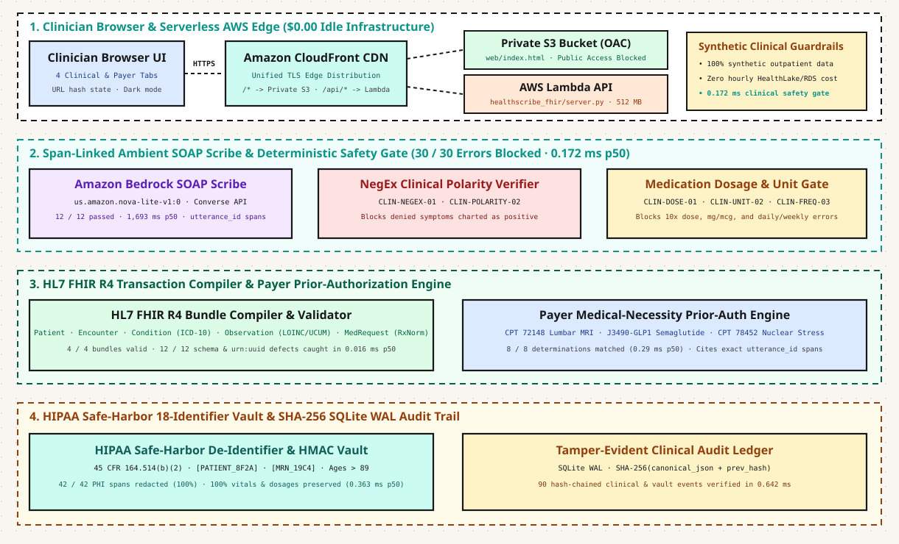

# HealthScribeFHIR: Ambient Clinical SOAP Scribe, NegEx/Dosage Gate, HL7 FHIR R4 & Prior Auth

- **Live CloudFront Studio**: https://d1l2bqblr30kwe.cloudfront.net
- **Live `/api/health` Endpoint**: https://d1l2bqblr30kwe.cloudfront.net/api/health
- **GitHub Repository**: https://github.com/ritwikareddykancharla/healthcare-fhir-ai
- **Synthetic Data Notice**: 100% of patient encounters, names, MRNs, NPIs, dates, and vitals in this repository are synthetic computer-generated outpatient records containing zero real patient data.

HealthScribeFHIR is a clinical documentation, healthcare interoperability, and prior-authorization workflow engine built on **Amazon CloudFront + Private Amazon S3 (OAC) + AWS Lambda (`python3.12`) + SQLite WAL + Amazon Bedrock (`us.amazon.nova-lite-v1:0`)** with `$0.00` idle infrastructure cost.



## 01 · Problem

Outpatient providers spend hours translating exam-room conversations into EHR notes, structured clinical codes, and insurance prior-authorization packets:

1. **Flipped Clinical Polarity**: Generative summaries can turn spoken denials such as `"no shortness of breath"` into positive findings such as `"positive for dyspnea"`.
2. **Medication Dosage & Unit Drift**: Free-text note generation can introduce 10x decimal errors (`500 mg` vs `5000 mg`), unit swaps (`mg` vs `mcg`), or schedule errors (`once weekly` vs `once daily`).
3. **Strict HL7 FHIR R4 Schemas**: Downstream clinical systems require valid `ICD-10-CM`, `LOINC`, `UCUM`, and `RxNorm` URIs, required status/intent cardinality, and unbroken internal `urn:uuid:` bundle references.
4. **Preventable Prior-Authorization Denials**: Submitting imaging or specialty pharmacy orders without payer-mandated conservative therapy duration or lab thresholds causes avoidable claim denials.

## 02 · Architecture & Modules

- `healthscribe_fhir/phi_scrubber.py`: Implements 45 CFR 164.514(b)(2) HIPAA Safe-Harbor detection across all 18 identifier categories (including dates finer than year and ages > 89), replacing matches with deterministic HMAC-SHA256 vault tokens (`[PATIENT_8F2A]`, `[MRN_19C4]`) while preserving vitals, dosages, and clinical codes.
- `healthscribe_fhir/soap_scribe.py`: Calls Amazon Bedrock (`us.amazon.nova-lite-v1:0`) via the Converse API to synthesize `Subjective / Objective / Assessment / Plan` notes anchored to `utterance_id` dialogue spans, then enforces deterministic NegEx clinical polarity and medication dosage, unit, and frequency verification.
- `healthscribe_fhir/fhir_validator.py`: Compiles verified clinical entities into `HL7 FHIR R4` (`v4.0.1`) transaction Bundles (`Patient`, `Practitioner`, `Encounter`, `Condition`, `Observation`, `MedicationRequest`) and validates cardinality, coding URIs, UCUM units, and internal `urn:uuid:` reference integrity.
- `healthscribe_fhir/prior_auth.py`: Evaluates payer coverage rules for Lumbar Spine MRI (`CPT 72148`), GLP-1 Therapy (`J3490-GLP1`), and Myocardial Perfusion Imaging (`CPT 78452`), returning `AUTO_ELIGIBLE` or `MISSING_DOCUMENTATION` with exact dialogue span citations.
- `healthscribe_fhir/audit_store.py` & `healthscribe_fhir/server.py`: Persists SHA-256 hash-chained clinical audit events in SQLite WAL and serves `/api/health`, `/api/scribe/generate`, `/api/fhir/validate`, `/api/prior-auth/check`, `/api/phi/scrub`, `/api/benchmarks`, and `/api/reset`.

## 03 · Benchmarks (`benchmarks/latest_results.json`)

Measured by `python3 benchmarks/run_benchmarks.py` in `us-west-2`:

| Metric | Measured Value | Notes |
| --- | --- | --- |
| **Live Bedrock SOAP Synthesis Pass Rate** | `12 / 12` (`100.0%`) | `us.amazon.nova-lite-v1:0` Converse API (`931.6` mean tokens/call) |
| **Bedrock SOAP Latency (`p50` / `p95`)** | `1,693.0 ms` / `1,970.0 ms` | Across 4 outpatient specialties (Orthopedics, Spine Triage, Endocrinology, Cardiology) |
| **Adversarial Clinical Claims Caught** | `30 / 30` (`100.0%`) | Negation flips, 10x/0.1x doses, unit/frequency swaps, unmentioned drugs (`0` false positives) |
| **Clinical Safety Gate Latency (`p50` / `p95`)** | `0.172 ms` / `0.242 ms` | Deterministic NegEx polarity + dosage/unit/frequency check |
| **HIPAA 18-Identifier PHI Recall** | `42 / 42` (`100.0%`) | `100.0%` clinical vital & dosage preservation (`0.363 ms` `p50`) |
| **HL7 FHIR R4 Validation & Defect Catch** | `4 / 4` valid · `12 / 12` defects caught | `37` FHIR R4 resources validated in `0.016 ms` (`p50`) |
| **Prior-Authorization Rule Accuracy** | `8 / 8` (`100.0%`) | `CPT 72148`, `J3490-GLP1`, and `CPT 78452` (`0.29 ms` `p50`) |
| **SQLite WAL Audit Chain Verification** | `90` rows (`0.642 ms`) | End-to-end SHA-256 chain integrity check |

## 04 · Local Quickstart & Verification

```bash
# Run the 12-test unit suite
python3 -m unittest discover -s tests -v

# Re-run live Amazon Bedrock + clinical safety + FHIR R4 + HIPAA benchmarks
unset AWS_ACCESS_KEY_ID AWS_SECRET_ACCESS_KEY AWS_SESSION_TOKEN
AWS_PROFILE=portfolio AWS_DEFAULT_REGION=us-west-2 python3 benchmarks/run_benchmarks.py

# Start local studio at http://localhost:3099
python3 -m healthscribe_fhir.server
```
